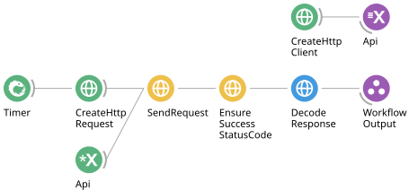

# Make your first request

This walkthrough retrieves current weather and decodes the response into text. No API key is needed for Open-Meteo's non-commercial API.

## Prepare your environment

Use Windows x64 with [Bonsai](https://bonsai-rx.org/docs/) installed and available as `bonsai` on PATH, the [.NET 8 SDK](https://dotnet.microsoft.com/download/dotnet/8.0), and PowerShell 7 (`pwsh`). Clone this repository, then run commands from its root:

```powershell
git clone https://github.com/bruno-f-cruz/Bonsai.Http.git
cd Bonsai.Http
pwsh docs/examples/run.ps1 08-response-text
```

The launcher builds the local libraries and opens the workflow with those libraries available. You do not need to publish or install a NuGet package first. Close Bonsai before rebuilding libraries that an editor session has loaded.

If you already have the packages installed from a package feed, the same operators can be added from Bonsai's toolbox. The source launchers are the reproducible route for this development checkout.

## Follow the graph



[Download the workflow](../examples/08-response-text.bonsai).

1. `CreateHttpClient` creates a reusable client with `BaseAddress = https://api.open-meteo.com/` and a 20-second timeout.
2. `ResourceSubject`, named `Api`, owns the client. `SubscribeSubject` with the same name supplies it to the second input of `SendRequest`.
3. `Timer` triggers `CreateHttpRequest`. Its `Uri` contains `/v1/forecast` and the latitude, longitude, and requested weather fields.
4. `SendRequest` takes the request as its first input and the shared client as its second input.
5. `EnsureSuccessStatusCode` raises an error for a non-2xx response.
6. `DecodeResponse`, with `Format = Text`, emits the decoded response body as a string.

The two inputs of `SendRequest` have different types. Connect request values to **Source1** and the client resource to **Source2**.

## Run and inspect

Press **F5** to start. The first request runs after one second; the Timer repeats every 15 minutes.

Double-click `SendRequest` and select the HTTP response visualizer if Bonsai offers more than one. It displays the status, originating request, headers, timing, and body preview. Double-click `DecodeResponse` for the decoded string. Stop with **Shift+F5**.

Look for `current.temperature_2m`, `current.relative_humidity_2m`, and `current.wind_speed_10m`. Units are listed under `current_units`. These are weather model estimates, and values change over time.

## Try a change

- Change the latitude and longitude in `CreateHttpRequest.Uri` to use another location.
- Set `DecodeResponse.Format` to `Json` to output `JsonNode` values instead of strings.
- Disconnect the Timer to have `CreateHttpRequest` emit once and complete. With an input, it emits once per input notification.
- Double-click `CreateHttpRequest` to edit its method, URI, headers, and body with the Dear ImGui editor.

Stop and restart after changing configuration. Request properties are captured at subscription, and the decoder's output type is selected when the workflow is built.

## If it does not run

| Symptom | What to check |
| --- | --- |
| The launcher cannot find Bonsai | Install Bonsai with the PATH option enabled; check `Get-Command bonsai` |
| A library cannot be copied during build | Close the editor session holding that library, then rerun the launcher |
| Relative requests fail | Set an absolute `BaseAddress`, or use an absolute request URI |
| The sequence times out | Check connectivity and the client timeout; increase it or clear it, then restart |
| No response is visible | Start the workflow before opening the response visualizer; check both `SendRequest` inputs |

Continue with [client configuration](client.md) or [running a server](server.md).
