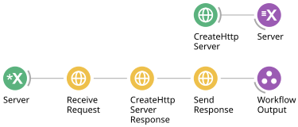

# Serve an HTTP endpoint

`Bonsai.Http.Server` turns an HTTP route into an observable sequence of incoming requests. Each request carries the capability to reply to its own caller, preserving correlation when several requests arrive together.

## Run the local example

From the repository root:

```powershell
pwsh docs/examples/run.ps1 05-local-server
```

Press **F5** in Bonsai. In another terminal:

```powershell
Invoke-RestMethod http://127.0.0.1:8080/hello
```

The response is JSON:

```json
{"message":"Hello from Bonsai"}
```



[Download the workflow](../examples/05-local-server.bonsai).

## Follow the server graph

1. `CreateHttpServer` configures `Url = http://127.0.0.1:8080/` and `RequestDeadline = 10 seconds`.
2. A `ResourceSubject` named `Server` owns the listener resource.
3. `SubscribeSubject`, also named `Server`, supplies the resource to `ReceiveRequest`.
4. `ReceiveRequest` registers `Method = GET` and `Pattern = /hello`. It starts the server and emits a context for every matching request.
5. `CreateHttpServerResponse` pairs that context with status 200, content type `application/json`, and a UTF-8 JSON body.
6. `SendResponse` sends the paired response back to that request's caller.

Stop the workflow to release the listener. Change configuration while stopped and restart it. If port 8080 is already in use, choose another port in `CreateHttpServer.Url` and in your test command.

## Match paths and inspect requests

Use a route template such as `/items/{id}`. Parameters must occupy an entire path segment. A request for `/items/42` produces a context whose `RouteValues["id"]` is `"42"`.

`HttpServerRequestContext` exposes `RequestId`, `Method`, `Uri`, `Headers`, `Body`, and `RouteValues`. The URI includes the query string; query parameters do not form part of route-template matching. Request bodies are buffered as bytes.

An unknown path receives 404. A known path with an unregistered method receives 405 with an `Allow` header. A body larger than `MaxRequestBodyBytes` receives 413. The default body limit is 16 MiB.

## Build a dynamic reply

`CreateHttpServerResponse` emits the same configured reply for each request. To build a response from request data, use an extension that maps the context to an `HttpServerExchange`:

```csharp
public IObservable<HttpServerExchange> Process(
    IObservable<HttpServerRequestContext> source)
{
    return source.Select(request =>
    {
        var body = System.Text.Json.JsonSerializer.SerializeToUtf8Bytes(new
        {
            id = request.RouteValues["id"],
            message = "Hello from Bonsai"
        });
        return new HttpServerExchange(request,
            new HttpServerResponse(200, body, "application/json"));
    });
}
```

Connect that operator after a `ReceiveRequest` configured for `/items/{id}`, then connect its output to `SendResponse`. The snippet needs `System.Reactive.Linq` and `Bonsai.Http.Server` imports.

Reply once per context and before `RequestDeadline`. A second reply is rejected. The current server returns 500 when its reply deadline expires; it does not synthesize a 504 response.

## Runtime and HTTPS

The Bonsai editor uses the .NET Framework implementation backed by `HttpListener`. .NET 8 hosts use Kestrel. Framework listening permissions depend on the URL reservation and host configuration. If the operating system rejects the listener, use an appropriate URL reservation for your account.

For HTTPS on .NET 8, configure `CertificatePath` and, if needed, `CertificatePassword`. Framework HTTPS uses an operating-system certificate binding instead. Start with the loopback HTTP example above to verify the workflow before configuring HTTPS.
